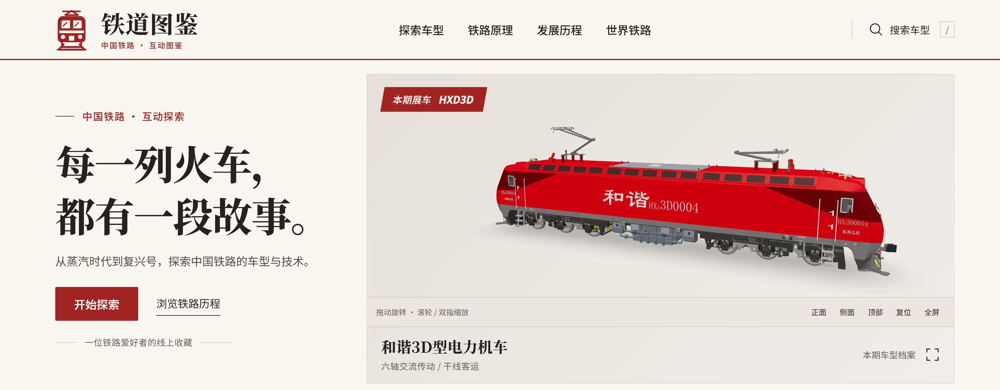
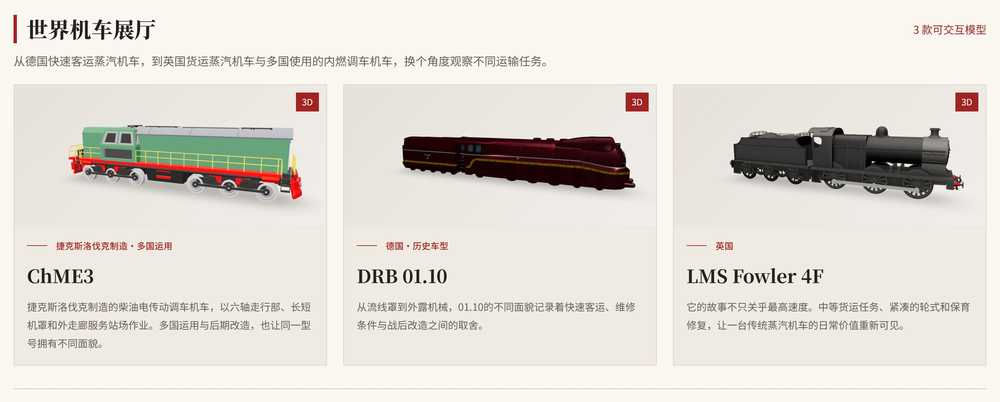

  
  <h1>Rail Atlas · 铁道图鉴</h1>
  
<strong>每一列火车，都有一段故事。</strong>

  

  

    
    
  

  
<a href="https://woniu101.github.io/rail-atlas/"><strong>打开铁道图鉴</strong></a> · <a href="#在这里可以探索什么">功能介绍</a> · <a href="#世界铁路换个角度看火车">世界铁路</a>

---

铁道图鉴是一位铁路爱好者的线上收藏。从蒸汽机车到复兴号，从车轮下的原理到铁路发展的故事，希望让喜欢火车的人看得尽兴，也让第一次认识铁路的人轻松开始。

> 页面预览可点击打开高分辨率原图。想亲手转动展车，请进入[在线网站](https://woniu101.github.io/rail-atlas/)。

## 在这里可以探索什么

### 认识一款火车

按蒸汽机车、内燃机车、电力机车和动车组浏览，打开车型档案，了解它诞生的背景、承担的任务和容易辨认的外形特点。参数附有口径说明与参考来源，方便继续查阅。

当前收录 **11款中国车型**，包括前进型、东风4B、东风4D、韶山3、韶山9、ND5、和谐系列机车、CRH380A与CR400AF。

[浏览全部车型](https://woniu101.github.io/rail-atlas/trains/)

### 转动展车，换个角度观察

拖动旋转、滚轮或双指缩放，也可以切换正面、侧面和顶部视角，放大观察车头、受电弓、车体与走行部。支持复位和全屏查看，手机上点击后即可开启探索。

目前提供 **12款具名车型的3D展示**，另有1款通用原理示意模型。前进型、CRH380A与CR400AF采用明确标注的简化模型；两款动车当前展示头车。模型的表现范围会在对应页面说明。

[从和谐3D型开始观察](https://woniu101.github.io/rail-atlas/trains/hxd3d/)

### 看懂外形背后的原理

“火车没有方向盘，为什么能转弯？”“内燃机车为什么也用电机？”“一列火车怎样平稳停下来？”从熟悉的问题出发，用图解与分段讲解理解技术。

**7篇原理专题**覆盖轮轨转弯、转向架、蒸汽动力、内燃电传动、受电弓供电、制动和信号闭塞。文章配有阅读要点、章节目录，并与相关车型相连，方便边看实车边理解原理。

[阅读铁路原理](https://woniu101.github.io/rail-atlas/principles/)

### 沿着铁轨，走过不同的时代

沿时间轴浏览中国铁路的 **16个历史节点**，从早期铁路建设，到内燃、电气化和高速铁路发展。每个节点都有背景、变化意义和延伸阅读，把一款车放回它所处的时代。

[浏览铁路发展历程](https://woniu101.github.io/rail-atlas/history/)

## 世界铁路：换个角度看火车

中国铁路是图鉴的主体，世界铁路专栏则带来更多比较视角。通过 **5篇专题**，看看新干线的系统协同、TGV的铰接布局、重载运输的条件，以及跨境列车需要兼容的接口。

世界机车展厅还收录 **DRB 01.10、LMS Fowler 4F、ChME3** 三款可交互模型，并配有独立介绍，观察不同国家和运输任务怎样影响车辆设计。

[走进世界铁路](https://woniu101.github.io/rail-atlas/world/)

## 找到想看的内容

- **按类别浏览**：从车型目录选择感兴趣的车辆类型。
- **按关键词搜索**：输入中文车名、车型代号、别名或铁路问题，查找车型和文章。
- **顺着关联阅读**：从车型档案进入原理专题，再沿参考来源继续了解。
- **随时开始**：桌面和手机均可浏览；设备无法显示3D时，也能继续查看封面和图文。

[搜索车型与文章](https://woniu101.github.io/rail-atlas/search/)

## 关于这个图鉴

这是一个持续积累的非商业个人兴趣项目，与铁路运营方、制造商及官方机构无隶属关系。内容尽可能标明资料来源；模型用于外形观察与科普展示。

图片、模型与字体保留各自作者和许可，详见[素材说明](./docs/assets.md)与[权利说明](./NOTICE.md)。

想了解项目的运行与维护，可查阅[开发说明](./docs/development.md)、[部署说明](./docs/deployment.md)或[全部文档](./docs/README.md)。
