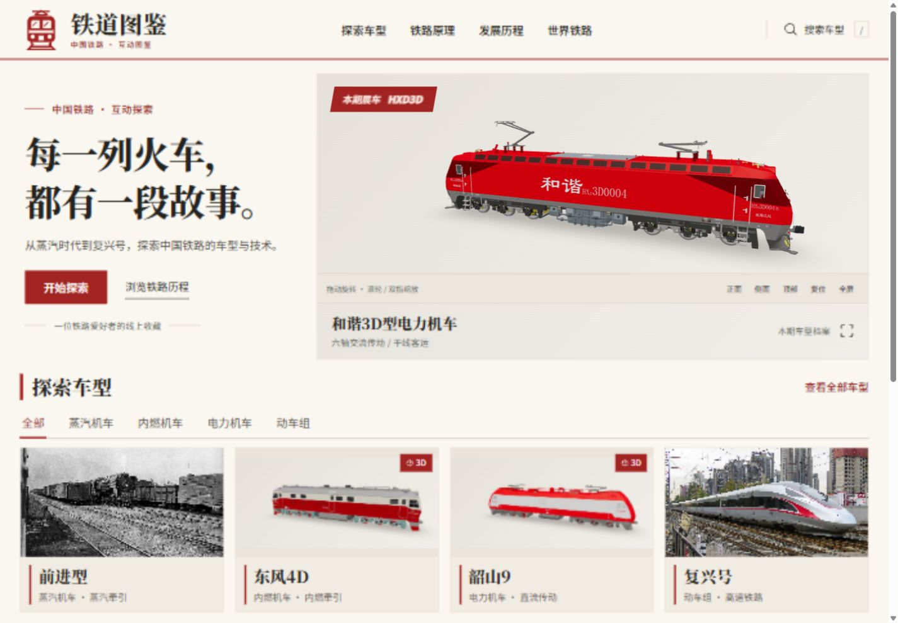
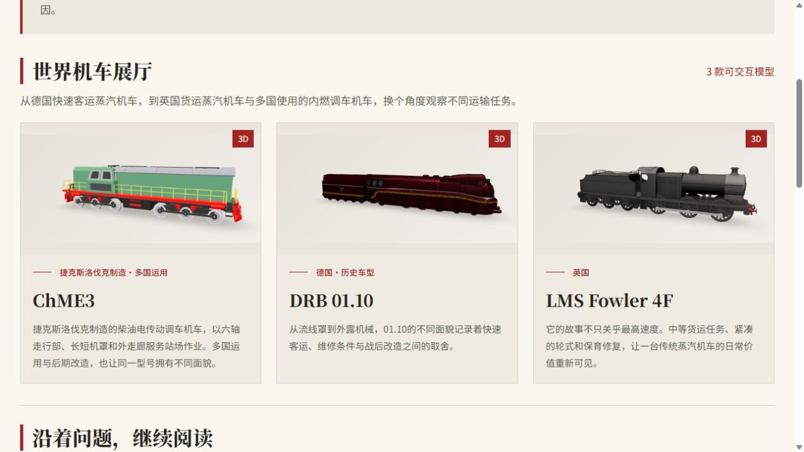

<div align="center">
  
  <h1>Rail Atlas · 铁道图鉴</h1>
  <p><strong>以中国铁路为主的互动科普图鉴，让每一列火车的故事被看见。</strong></p>
  <hr />
  <p>
    <a href="https://github.com/woniu101/rail-atlas/actions/workflows/deploy.yml"></a>
    
    
    
    
  </p>
  <p><a href="https://woniu101.github.io/rail-atlas/"><strong>在线体验</strong></a> · <a href="#本地开发">本地开发</a> · <a href="#部署">部署说明</a> · <a href="#素材与许可">素材与许可</a></p>
</div>

---

从蒸汽时代到复兴号，整理中国铁路车型、技术与发展故事，也用精选世界铁路案例拓宽观察角度。这是一个非商业的个人兴趣项目，与铁路运营方、制造商及官方机构无隶属关系。



## 功能

- **车型档案**：11款中国车型，涵盖蒸汽、内燃、电力机车与动车组，提供参数口径、识别线索、运用背景和资料来源。
- **3D展车**：12款具名车型及1款通用原理模型，支持旋转、缩放、预设视角、复位和全屏，提供手机优化副本。
- **原理科普**：7篇图解文章，覆盖轮轨转弯、转向架、蒸汽动力、电传动、供电、制动和闭塞。
- **铁路历程与世界铁路**：16个历史节点、5篇世界铁路专题和3款世界机车的独立介绍。
- **静态全文搜索**：Pagefind中文搜索，支持车型名称、代号、别名与文章内容。
- **响应式阅读**：本地中文字体、手机端按需加载模型，以及WebGL不可用或加载失败时的图文回退。



## 本地开发

需要 **Node.js 24 LTS**。项目用pnpm锁定依赖，首次安装：

```sh
git clone https://github.com/woniu101/rail-atlas.git
cd rail-atlas
npm install -g pnpm@11.25.0
pnpm install --frozen-lockfile
pnpm dev
```

终端会显示本地地址，通常为 `http://127.0.0.1:4321/`。依赖安装完成后，也可以直接用 `npm run dev` 启动，无需每次输入pnpm。

完整搜索体验需要构建索引后预览：

```sh
npm run check
npm run build
npm test
npm run preview
```

开发模式不包含Pagefind索引；搜索、模型和科普页面都不需要后端、数据库或API密钥。已提交网页运行所需的模型、贴图、字体和解码器，克隆后无需重新下载原始GLB。

## 部署

**在线地址：[woniu101.github.io/rail-atlas](https://woniu101.github.io/rail-atlas/)**

仓库通过 [GitHub Actions](./.github/workflows/deploy.yml) 构建并部署GitHub Pages。推送到 `main` 会自动执行依赖安装、类型检查、静态构建和测试；全部通过后发布 `dist/`。PR只运行构建检查，不部署。

部署环境配置为：

| 变量 | GitHub Pages值 | 用途 |
| --- | --- | --- |
| `SITE_URL` | `https://woniu101.github.io` | 正式站点域名及canonical |
| `SITE_BASE` | `/rail-atlas` | 页面、模型、字体、解码器和搜索结果的子目录前缀 |
| `PUBLIC_ASSET_BASE` | 留空 | 使用本站静态资源 |

本地默认根路径 `/`，无需 `.env`。将来放到阿里云Nginx或自定义域名时，按实际地址设置以上变量重新构建，部署整个 `dist/` 即可。步骤见 [部署维护说明](./docs/deployment.md)。

## 项目结构

```text
.github/workflows/       GitHub Pages自动构建与发布
src/content/trains/      中国车型档案
src/content/world-models/ 世界机车资料与模型元数据
src/content/articles/    原理与世界铁路专题
src/components/          页面组件、SVG图解、3D查看器
src/data/                铁路历史时间轴
src/pages/               Astro静态路由
src/styles/              全站样式与响应式排版
public/images/           图片与实际模型渲染封面
public/models/           桌面/手机GLB、解码器和来源清单
public/fonts/            本地中文字体子集与许可
scripts/                 模型准备、备份与字体维护工具
assets/                  模型来源记录、导出依据与本地原件
model-backups/           原始GLB统一命名备份（大文件仅本地）
docs/                    产品、素材、查证、部署与开发记录
tests/                   静态页面、来源、模型与备份检查
```

文档入口见 [docs/README.md](./docs/README.md)，产品范围见 [prd.md](./prd.md)。正式构建包含34个页面，Pagefind索引排除搜索页和404页。

## 模型与备份

| 类别 | 已接入车型 | 说明 |
| --- | --- | --- |
| 中国机车 | HXD3D、HXD2、HXD3B、DF4D、SS9、ND5 | chinarailstory作品，CC BY 4.0 |
| 中国简化车型 | 前进型QJ、CRH380A、CR400AF | Rail Island作品，CC0；QJ仅机车本体，动车仅头车 |
| 世界机车 | DRB 01.10、LMS Fowler 4F、ChME3 | 分别保留原作者和CC BY 4.0署名 |
| 原理示意 | 通用高速列车 | Tevy作品，CC0，不对应具体真实型号 |

网站使用整理压缩后的副本，保留作者、来源、许可和修改说明。源模型的细节与比例受作者建模质量限制，不能作为工程图纸或维修依据；仅通用原理模型提供示意部件热点。

原始GLB共13份，统一命名存放于 `model-backups/`，SHA-256与原件一致。原件及备份GLB不提交Git，也不进入网站构建；迁移本地完整备份需另行复制。仓库保留 [备份清单](./model-backups/manifest.json) 和 [命名说明](./model-backups/README.md)。普通克隆与CI检查不要求这些原件；本地存在备份时，测试会逐一核验全部13份。

## 内容与素材维护

- 新增/修改车型、文章：编辑 `src/content/` 中的Markdown。frontmatter采用JSON格式（合法YAML），`draft`条目不会生成公开页面。
- 新增模型：先登记来源与授权，再使用 `scripts/prepare-models.mjs` 归档和优化；按需指定源目录和车型slug，步骤见 [模型获取说明](./docs/model-downloads.md)。
- 新增文字：运行 `python scripts/build-font-subsets.py` 更新本地字形；需安装 `fonttools[woff]`，详见 [字体说明](./docs/fonts.md)。
- 修改后执行类型检查、构建和测试，检查桌面与手机布局，再推送到 `main`。

## 素材与许可

照片、模型、字体和第三方代码各自保留原作者许可。个人兴趣和非商业用途不会替代署名或相同方式共享等要求。逐文件记录见 [素材清单](./scripts/assets-manifest.json)、[素材说明](./docs/assets.md) 和网站“关于本站与素材说明”页面。

仓库公开可见不代表第三方素材自动改为统一许可；请按相应条目处理。本站原创代码与文字尚未单独声明开源许可。转载或复用时需区分代码、文章和素材各自的权利范围，详见 [NOTICE.md](./NOTICE.md)。
